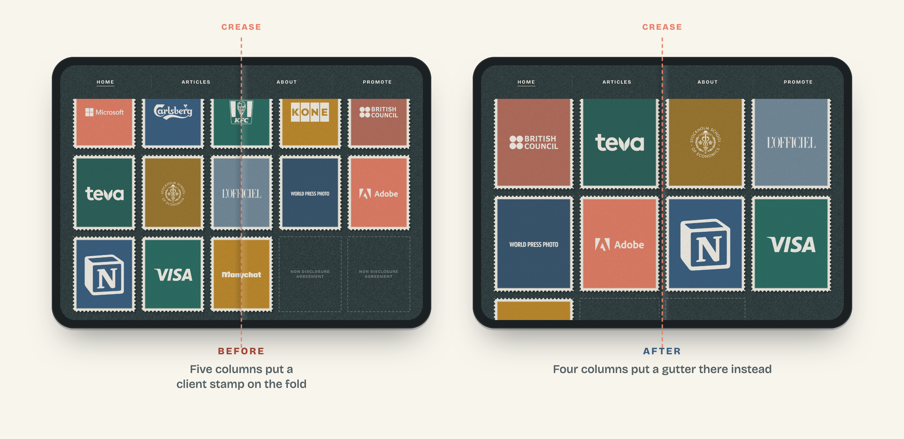

# Fold audit

**Find every button your site loses to a foldable's crease - and fix it before your visitors find it first.**



iPhone Duo opens into a nearly square screen with a crease down the middle. Taps
there register badly, and Safari gives websites no way to ask where the fold is.
So a "Buy" button, a newsletter field or a menu link that happens to sit in the
middle of the page quietly stops working for the people with the newest phone.

This is a Claude skill that audits your pages, fixes them with one isolated block
of CSS, proves the fix, and draws the before-and-after picture.

## What you get

- **An audit script** that opens your pages at every pose of the device - closed,
  opened at both published sizes, and in Split View - with touch input emulated,
  and lists each control on the crease with its text and position.
- **A fix playbook** of width-independent CSS moves that clear the crease without
  touching the rest of your site.
- **A mockup generator** that puts any page on an opened device with the crease
  drawn in, for client reports, case studies and posts.
- **An in-app browser probe** for the other place mobile pages break: links opened
  from Instagram, TikTok, Telegram and LinkedIn.

## Who it is for

- Agencies checking a client portfolio before launch day
- Performance marketers whose landing pages get traffic from social apps
- Online shops whose cart and checkout buttons sit mid-page
- SaaS teams with signup flows opened from LinkedIn and Telegram

## Use it

**Claude Code, as a plugin:**

```
/plugin marketplace add gurovdigital/fold-audit
/plugin install fold-audit@gurovdigital
```

Then ask Claude to "audit example.com for iPhone Duo".

**Claude Code, by hand:** copy `plugins/fold-audit/skills/fold-audit` into `~/.claude/skills/`.

**Claude apps:** download `fold-audit-skill.zip` from the [latest release](https://github.com/gurovdigital/fold-audit/releases/latest) and upload it under Settings > Capabilities > Skills.

**Without Claude:** the scripts run on their own.

```
node plugins/fold-audit/skills/fold-audit/scripts/fold-audit.mjs https://example.com --shots
node plugins/fold-audit/skills/fold-audit/scripts/duo-mockup.mjs https://example.com --scroll ".pricing"
```

Requirements: Node 22 or newer and Google Chrome.

## Be honest with your results

The audit runs in emulation. Apple has published two different sizes for the
opened screen, so the skill checks both. Confirm on the device before you promise
a client anything - the included probe page settles the width with one photo.

---

Made by Pavel Gurov · [gurovdigital.com](https://gurovdigital.com)

iPhone is a trademark of Apple Inc. This project is not affiliated with or endorsed by Apple.
