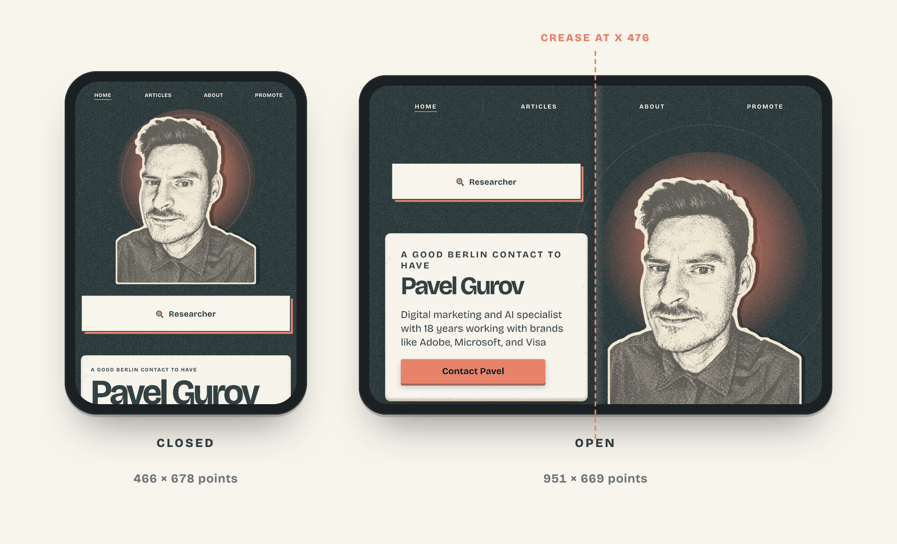
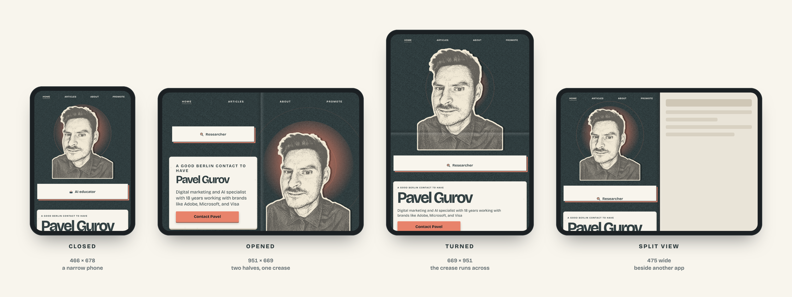
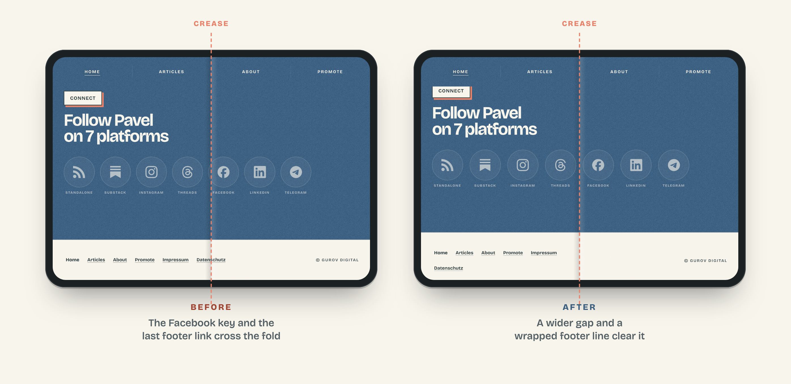

# Duo-ready

**Make your website look its best on iPhone Duo - closed, opened and every pose in between.**



iPhone Duo is two phones in one. Closed, it is a narrow phone. Opened, it is a nearly square 7.6-inch screen with a crease down the middle. Taps on the crease register badly, and Safari gives websites no way to ask where the fold is. So a "Buy" button, a newsletter field or a menu link that happens to sit in the middle of the page quietly stops working for the people with the newest phone.

Duo-ready is a Claude skill that gets your site ready for the whole device. It reads your pages at every pose, moves every control off the crease with one isolated block of CSS, and shows you the before and after.



## What it does

- Reads every page at every pose - closed, opened at both published sizes, turned, and in Split View - with touch input emulated, and finds what breaks: controls on the crease and sideways scrolling
- Fixes them with width-independent CSS moves kept in one block that touches nothing else on the site
- Handles what Safari won't tell you: the crease, the Dynamic Island standing on the side of the closed screen, and the in-app browsers of Instagram, TikTok, Telegram and LinkedIn
- Renders device mockups with the crease drawn in, for client reports, case studies and posts




## Who it is for

- Agencies getting client sites ready before launch day
- Performance marketers whose landing pages get traffic from social apps
- Online shops whose cart and checkout buttons sit mid-page
- SaaS teams with signup flows opened from LinkedIn and Telegram

## Use it

**Claude Code, as a plugin:**

```
/plugin marketplace add gurovdigital/duo-ready
/plugin install duo-ready@gurovdigital
```

Then ask Claude to "get example.com ready for iPhone Duo".

**Claude Code, by hand:** copy `plugins/duo-ready/skills/duo-ready` into `~/.claude/skills/`.

**Claude apps:** download `duo-ready-skill.zip` from the [latest release](https://github.com/gurovdigital/duo-ready/releases/latest) and upload it under Settings > Capabilities > Skills.

**Without Claude:** the scripts run on their own.

```
node plugins/duo-ready/skills/duo-ready/scripts/duo-check.mjs https://example.com --shots
node plugins/duo-ready/skills/duo-ready/scripts/duo-mockup.mjs https://example.com --scroll ".pricing"
```

Requirements: Node 22 or newer and Google Chrome.


## Be honest with your results

The checks run in emulation. Apple has published two different sizes for the opened screen, so the skill checks both. Confirm on the device before you promise a client anything - the included probe page settles the width with one photo.

Made by Pavel Gurov · [gurovdigital.com](https://gurovdigital.com)

iPhone is a trademark of Apple Inc. This project is not affiliated with or endorsed by Apple.
